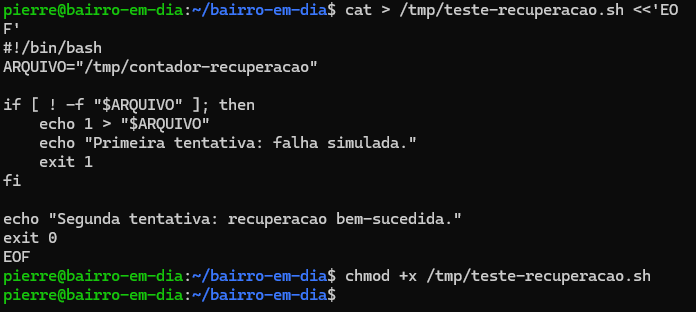
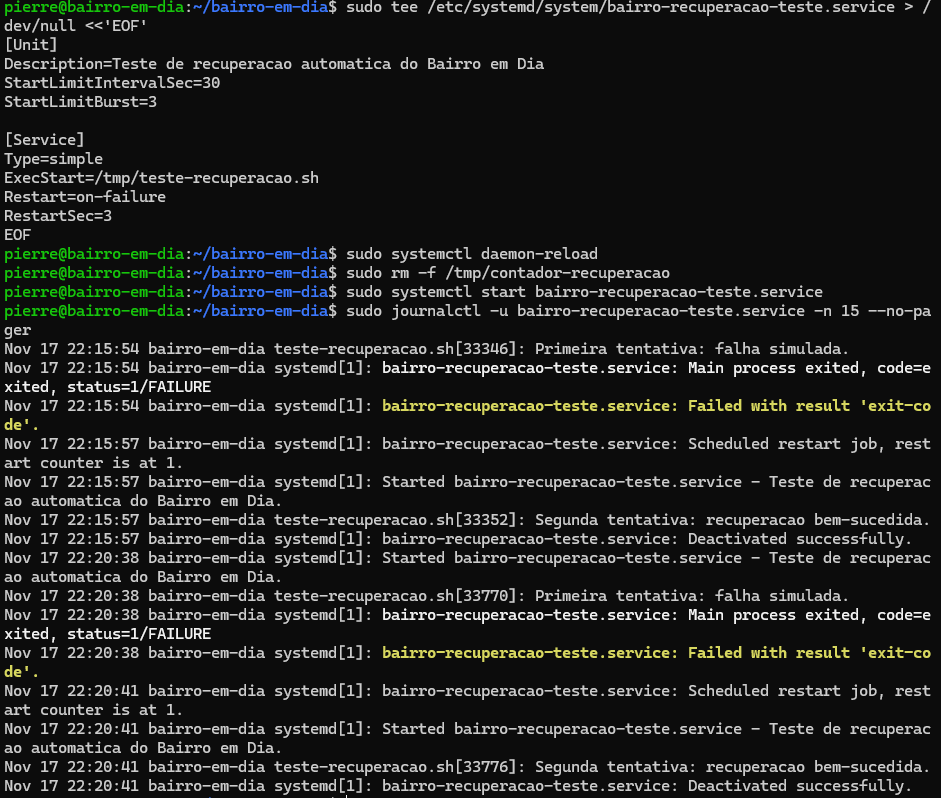
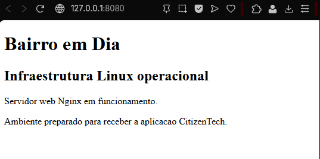

# Bairro em Dia

Projeto acadêmico desenvolvido para a Global Solution da FIAP 2026.

## Objetivo

Preparar uma infraestrutura Linux para hospedar e apoiar a aplicação CitizenTech, com automação, monitoramento de recursos e auditoria dos serviços.

## Tecnologias utilizadas

- Ubuntu Server
- Bash Script
- systemd
- Nginx
- UFW (Firewall)
- VirtualBox

## Estrutura do projeto

```text
bairro-em-dia/
├── backups/
├── evidencias/
│   ├── E01-infraestrutura-operacional.png
│   ├── E04-monitoramento-recursos.png
│   ├── E07-recuperacao-pt1.png
│   ├── E07-recuperacao-pt2.png
│   └── E08-servidor-web-nginx.png
├── logs/
├── scripts/
│   ├── auditoria.sh
│   ├── diagnostico-infra.sh
│   ├── monitoramento.sh
│   └── provision-infra.sh
├── .gitignore
└── README.md

```
## Scripts

- **provision-infra.sh:** prepara o ambiente, configura hostname e firewall, instala e configura o Nginx e valida a rede.
- **diagnostico-infra.sh:** coleta informações do sistema, rede, DNS e serviços.
- **monitoramento.sh:** acompanha CPU, memória e disco, registrando alertas quando os limites são ultrapassados.
- **auditoria.sh:** verifica serviços, unidades com falha e registros do sistema.

## Monitoramento

Limites configurados para alertas:

| Recurso | Limite |
|---|---:|
| CPU | 85% |
| Memória | 85% |
| Disco | 80% |

O monitoramento é executado automaticamente por um serviço e um timer do systemd, com intervalo de um minuto.

## Como executar

Na pasta do projeto, execute:

- `./scripts/provision-infra.sh`
- `./scripts/diagnostico-infra.sh`
- `./scripts/monitoramento.sh`
- `./scripts/auditoria.sh`

## Servidor web

O Nginx disponibiliza uma página inicial de validação da infraestrutura na porta 80.

A integração com a aplicação CitizenTech ainda depende da disponibilização dos componentes da aplicação e da definição de sua configuração de hospedagem.

## Configuração de rede

A interface de rede utiliza DHCP. O script de provisionamento realiza backup das configurações Netplan existentes e valida conectividade, endereço IP, gateway e DNS.

## Observação

Os diretórios `logs/` e `backups/` são utilizados localmente. Seus conteúdos são excluídos do versionamento para evitar a publicação de informações específicas da máquina.

## Evidências

As evidências abaixo demonstram o funcionamento da infraestrutura,
o monitoramento de recursos, o teste de recuperação e o servidor web.

### E01 — Infraestrutura operacional


### E04 — Monitoramento de recursos


### E07 — Teste de recuperação

**Parte 1:**


**Parte 2:**


### E08 — Servidor web Nginx

