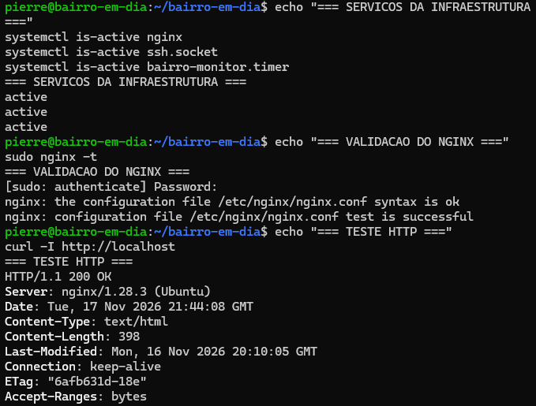
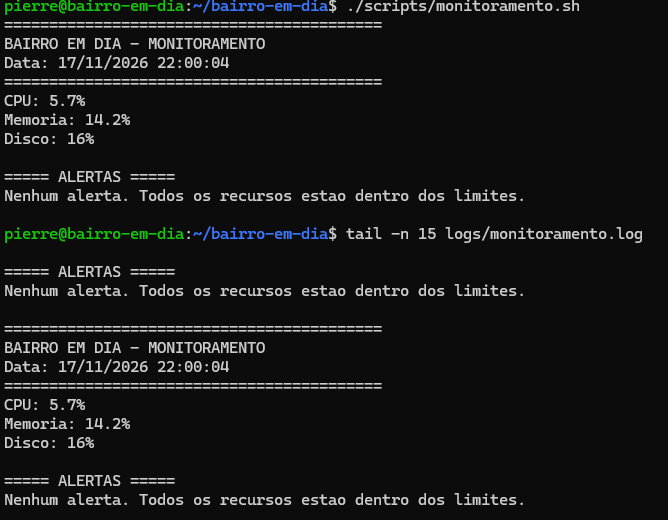
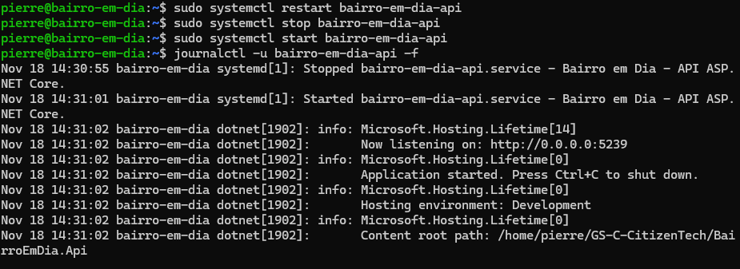
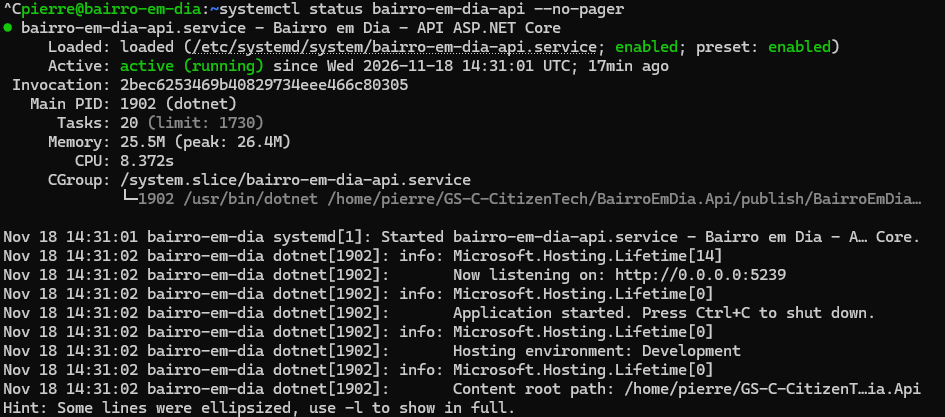

# Bairro em Dia

Projeto acadêmico desenvolvido para a Global Solution da FIAP 2026.

## Objetivo

Preparar uma infraestrutura Linux para hospedar e apoiar a aplicação CitizenTech, com automação, monitoramento de recursos e auditoria dos serviços.

## Tecnologias utilizadas

- Ubuntu Server
- Bash Script
- systemd
- Nginx
- ASP.NET Core / .NET 10
- SQLite
- UFW (Firewall)
- VirtualBox

## Estrutura do projeto

```text
bairro-em-dia/
├── backups/
├── config/
│   └── systemd/
│       └── bairro-em-dia-api.service
├── evidencias/
│   ├── E01-infraestrutura-operacional.png
│   ├── E04-monitoramento-recursos.png
│   ├── E07-recuperacao-pt1.png
│   ├── E07-recuperacao-pt2.png
│   └── E08-servidor-web-nginx.png
├── logs/
├── scripts/
│   ├── auditoria.sh
│   ├── diagnostico-infra.sh
│   ├── monitoramento.sh
│   └── provision-infra.sh
├── .gitignore
└── README.md

```
## Scripts

- **provision-infra.sh:** prepara o ambiente, configura hostname e firewall, instala e configura o Nginx e valida a rede.
- **diagnostico-infra.sh:** coleta informações do sistema, rede, DNS e serviços.
- **monitoramento.sh:** acompanha CPU, memória e disco, registrando alertas quando os limites são ultrapassados.
- **auditoria.sh:** verifica serviços, unidades com falha e registros do sistema.

## Monitoramento

Limites configurados para alertas:

| Recurso | Limite |
|---|---:|
| CPU | 85% |
| Memória | 85% |
| Disco | 80% |

O monitoramento é executado automaticamente por um serviço e um timer do systemd, com intervalo de um minuto.

## Como executar

Na pasta do projeto, execute:

- `./scripts/provision-infra.sh`
- `./scripts/diagnostico-infra.sh`
- `./scripts/monitoramento.sh`
- `./scripts/auditoria.sh`

## Servidor web e hospedagem da aplicação

O Nginx é responsável por disponibilizar o frontend da aplicação Bairro em Dia, enquanto a API ASP.NET Core é executada em segundo plano no Ubuntu Server.

### Frontend

- Servidor web: Nginx
- Porta interna: 80
- Acesso pelo host: `http://127.0.0.1:8080`
- Diretório de publicação: `/var/www/bairro-em-dia`

### Backend

- Tecnologia: ASP.NET Core / .NET 10
- Porta: 5239
- Execução: serviço systemd
- Unidade: `bairro-em-dia-api.service`
- Inicialização automática após boot
- Reinicialização automática em caso de falha

### Persistência

O banco de dados utilizado pela API é SQLite, armazenado localmente no diretório da aplicação. Os dados permanecem disponíveis após a reinicialização do servidor.

### Integração

O frontend comunica-se com a API por meio de requisições HTTP. A configuração de CORS permite a comunicação entre os serviços hospedados no ambiente.

A infraestrutura foi validada após a reinicialização da VM, confirmando que o frontend Nginx e a API ASP.NET Core voltaram a funcionar normalmente.

## Gerenciamento da API

A API é gerenciada pelo systemd, permitindo execução em segundo plano, inicialização automática e reinicialização em caso de falha.

Arquivo de configuração versionado:

`config/systemd/bairro-em-dia-api.service`

### Ambiente de execução

A configuração utilizada no ambiente acadêmico está definida como `Development`, permitindo o uso das ferramentas de documentação da API durante os testes.

Essa configuração é destinada ao ambiente de desenvolvimento e demonstração. Para uma implantação em produção, devem ser revisadas as configurações de ambiente, exposição de endpoints de documentação, segurança, credenciais e regras de acesso.

### Instalação do serviço

Copie o arquivo de configuração para o diretório de unidades do systemd:

```bash
sudo cp config/systemd/bairro-em-dia-api.service /etc/systemd/system/

## Configuração de rede

A interface de rede utiliza DHCP. O script de provisionamento realiza backup das configurações Netplan existentes e valida conectividade, endereço IP, gateway e DNS.

## Observação

Os diretórios `logs/` e `backups/` são utilizados localmente. Seus conteúdos são excluídos do versionamento para evitar a publicação de informações específicas da máquina.

## Evidências

As evidências abaixo demonstram o funcionamento da infraestrutura,
o monitoramento de recursos, o teste de recuperação e o servidor web.

### E01 — Infraestrutura operacional


### E04 — Monitoramento de recursos


### E07 — Teste de recuperação

**Parte 1:**


**Parte 2:**


### E08 — Servidor web Nginx


### E09 — API automatizada com systemd

Evidência da API em execução como serviço do sistema, com inicialização automática habilitada.


### E10 — Inicialização após reboot

Evidência da API funcionando após a reinicialização da VM, sem necessidade de execução manual.

